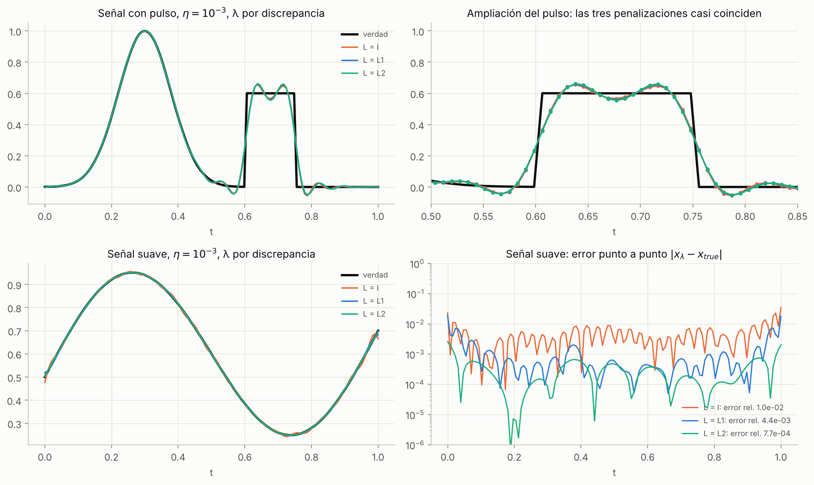
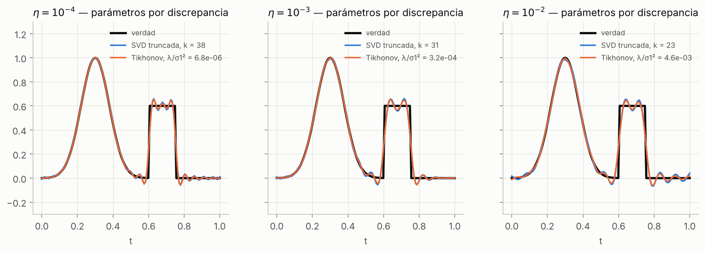
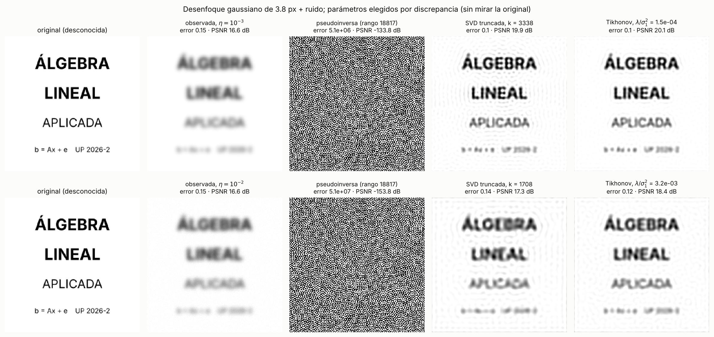

# Reconstrucción de señales con ruido: pseudoinversa, SVD truncada y Tikhonov

**Curso:** Álgebra Lineal Aplicada 2026-2 — Universidad del Pacífico

**Tema asignado:** Reconstrucción de señales con ruido (Pseudoinversa, SVD truncada y regularización de Tikhonov. Incluye selección del parámetro y experimento reproducible.)

**Versión:** Entrega final — etiqueta `entrega-final`

**Integrantes:** Paula Romero, Carlos Ledo y Matías Desmonteix

## Problema

Una señal $x_{\mathrm{true}}\in\mathbb R^{128}$ (una zona suave y un pulso rectangular) se observa a través de un suavizado gaussiano $A$ ($s=0.03$) y con ruido: $b=Ax_{\mathrm{true}}+e$, con nivel relativo $\eta\in\{10^{-4},10^{-3},10^{-2}\}$. Como $A$ atenúa casi por completo los detalles finos, la solución que mejor ajusta los datos amplifica el ruido. ¿Cómo reconstruir la señal sin amplificar lo que no sabemos y cómo elegir el parámetro de regularización **sin conocer** $x_{\mathrm{true}}$?

## Objetivo

1. Reproducir y verificar el ejemplo diagonal de dos coordenadas.
2. Comparar pseudoinversa numérica, SVD truncada y Tikhonov con error relativo, residuo y norma para los tres niveles de ruido.
3. Elegir el parámetro con el principio de discrepancia (sin $x_{\mathrm{true}}$) y cuantificar su distancia al mejor valor posible (oráculo).
4. Explicar con la SVD qué parte del error se debe al ruido y qué parte es información perdida.
5. Llevar el mismo método a datos que se puedan ver y oír: una imagen desenfocada y un sonido apagado (retroalimentación de la entrega parcial).
6. Ampliación: cambiar la penalización $\lambda\lVert x\rVert^2$ por $\lambda\lVert Lx\rVert^2$ (diferencias) y estimar el nivel de ruido a partir de los datos, para que toda la cadena funcione sin conocer ni $e$ ni $x_{\mathrm{true}}$.

## Qué se entrega

| Qué se entrega | Dónde |
|---|---|
| Problema, objetivo y alcance actualizados | `docs/desarrollo_matematico.md` (sección 1) |
| Desarrollo matemático con demostraciones | `docs/desarrollo_matematico.md` |
| Implementación | `reconstruccion/` (paquete) y `scripts/` |
| Resultados, comprobaciones e interpretación | `docs/resultados.md`, `resultados/` |
| Pruebas automáticas (61) | `tests/test_reconstruccion.py` (25), `tests/test_aplicaciones.py` (22), `tests/test_general.py` (14) |
| Ejemplos prácticos de imagen y audio | `docs/desarrollo_matematico.md` §9, `docs/resultados.md` §7, `resultados/imagen/`, `resultados/audio/` |
| Ampliación: penalización de diferencias (GSVD) | `docs/desarrollo_matematico.md` §10, `docs/resultados.md` §8, `reconstruccion/general.py`, `scripts/08_penalizacion_diferencias.py` |
| Estimación del nivel de ruido y refinamiento de $\lambda$ | `docs/desarrollo_matematico.md` §8.4, `docs/resultados.md` §9, `scripts/09_estimacion_delta.py` |
| Preguntas de defensa con respuestas | `docs/desarrollo_matematico.md` §11 |
| Guion del video y diapositivas | `docs/guion_video.md`, `docs/diapositivas/` |
| Responsabilidades, contribuciones, pendientes y cronograma | `docs/organizacion.md` |
| Declaración de uso de IA | `DECLARACION_IA.md` |

## Resultados principales (semilla 2026)

| $\eta$ | Pinv numérica (rango 89 de 128) | SVD truncada · discrepancia | Tikhonov · discrepancia | Tikhonov · oráculo |
|---|---|---|---|---|
| $10^{-4}$ | $8.1\times10^{7}$ | 0.094 ($k=38$) | 0.094 | 0.091 |
| $10^{-3}$ | $8.1\times10^{8}$ | 0.114 ($k=31$) | 0.109 | 0.101 |
| $10^{-2}$ | $8.1\times10^{9}$ | 0.122 ($k=23$) | 0.119 | 0.119 |

(error relativo $\lVert x-x_{\mathrm{true}}\rVert/\lVert x_{\mathrm{true}}\rVert$)

- La pseudoinversa ajusta los datos por debajo del nivel del ruido y aun así se equivoca por un factor de $10^{7}$ a $10^{10}$.
- Con regularización el error baja a 9–12 %. En 50 semillas, la discrepancia queda en mediana entre 0.5 % y 14 % por encima del oráculo.
- Subestimar el ruido a la mitad deja la regla sin solución en la malla (o la lleva a reproducir ruido); sobrestimarlo al doble cuesta poco. El nivel de ruido se puede estimar con la cola de los coeficientes de Picard: $\hat\delta/\lVert e\rVert\in[0.89,1.15]$ en 50 semillas, con el mismo error final.
- El error restante es casi todo sesgo en los bordes del pulso y baja muy despacio con el ruido: con $\eta=10^{-10}$ sigue en 6.5 % y sin ruido, en doble precisión, en 5.4 %.
- Ampliación: penalizar las diferencias ($\lambda\lVert L x\rVert^2$) no cambia nada para el pulso (las tres penalizaciones cortan en las mismas ≈ 30 direcciones), pero para una señal suave reduce el error diez veces (de 0.95 % a 0.09 % con $L_2$). La penalización es un modelo a priori de la señal.





## Ejemplo práctico: imagen y sonido

Después de la entrega parcial aplicamos las mismas reconstrucciones (en la imagen las tres; en el audio, pseudoinversa y Tikhonov), con el parámetro elegido por discrepancia, a una **imagen de 256 × 256 desenfocada** y a un **audio de 2 s con los agudos apagados**. En ambos casos el suavizado tiene el mismo ancho que el experimento principal (≈ 3.8 píxeles o muestras).



| Ejemplo | Observado | Pseudoinversa | Tikhonov · discrepancia |
|---|---|---|---|
| Foto (gato), $\eta=10^{-2}$ | 22.3 dB | ruido puro (pinv numérica: error $5\times10^{7}$) | **25.6 dB** |
| Texto, $\eta=10^{-3}$ | 16.6 dB | ruido puro | **20.1 dB**, vuelve a leerse |
| Audio, $\eta=10^{-2}$ | SNR 4.6 dB | ruido blanco (pinv completa: error $2\times10^{14}$) | **SNR 9.7 dB**, recupera los armónicos hasta ≈ 1 kHz |

- **Imagen:** el desenfoque es $B=A X A^T+E$. Su matriz $A\otimes A$ sería de 65 536 × 65 536 (≈ 34 GB), pero su SVD sale de la SVD de $A$ (producto de Kronecker), así que no se forma.
- **Audio:** el suavizado es una convolución circular; su SVD la da la transformada de Fourier, y Tikhonov actúa como un ecualizador que devuelve los agudos mientras sobresalen del ruido.
- **Para escuchar:** `resultados/audio/melodia_original.wav`, `melodia_observado_eta1e-2.wav` y `melodia_tikhonov_eta1e-2.wav`.
- **Con una foto o grabación propia:** `python scripts/05_imagen.py --imagen foto.jpg` y `python scripts/06_audio.py --audio voz.wav`.

## Organización del repositorio

```
├── README.md
├── DECLARACION_IA.md
├── requirements.txt
├── pytest.ini
├── reconstruccion/            # paquete con la implementación
│   ├── datos.py               #   señal, matriz de suavizado, ruido con semilla
│   ├── metodos.py             #   SVD, pinv, SVD truncada, Tikhonov (espectral, aumentado QR, normales)
│   ├── seleccion.py           #   discrepancia (sin x_true), oráculo (con x_true), estimación de delta, bisección
│   ├── metricas.py            #   error relativo, residuo, norma
│   ├── general.py             #   ampliación: Tikhonov con lambda ||L x||^2, GSVD por QR + SVD
│   ├── separable.py           #   imagen: B = A_v X A_h^T, SVD de Kronecker, TSVD y Tikhonov matriciales
│   └── circulante.py          #   audio: convolución circular, SVD vía Fourier
├── scripts/
│   ├── comun.py               # parámetros del experimento y estilo de figuras
│   ├── 01_ejemplo_diagonal.py
│   ├── 02_experimento_principal.py
│   ├── 03_robustez.py         # 50 semillas, sensibilidad a delta, caso sin ruido
│   ├── 04_variacion_s.py      # exploración: s = 0.02, 0.03, 0.05
│   ├── 05_imagen.py           # ejemplo práctico: gato y texto desenfocados (--imagen para una foto propia)
│   ├── 06_audio.py            # ejemplo práctico: melodía apagada (--audio para un .wav propio)
│   ├── 07_diagnosticos.py     # cifras citadas en la interpretación, barrido de eta, rango de A^T A
│   ├── 08_penalizacion_diferencias.py  # ampliación: I, L1 y L2 en dos señales, 50 semillas
│   ├── 09_estimacion_delta.py # nivel de ruido desde los datos y lambda refinado
│   └── ejecutar_todo.py
├── recursos/                  # gato_256.png (foto de prueba, scikit-image, CC0) y texto_256.png (imagen de texto congelada)
├── tests/
│   ├── test_reconstruccion.py
│   ├── test_aplicaciones.py   # imagen y audio contra las matrices grandes formadas en casos pequeños
│   └── test_general.py        # ampliación: GSVD, unicidad, límites, discrepancia
├── docs/
│   ├── desarrollo_matematico.md
│   ├── resultados.md
│   ├── guion_video.md
│   ├── diapositivas/          # diapositivas del video
│   └── organizacion.md
└── resultados/                # generado por los scripts
    ├── configuracion.json     # semilla, tolerancias, sigma_i, versiones
    ├── figuras/*.png
    ├── tablas/*.csv
    ├── imagen/*.png           # imágenes sueltas para las diapositivas
    └── audio/*.wav            # original, observado y reconstruido
```

## Cómo ejecutar

Requiere Python ≥ 3.10.

```bash
pip install -r requirements.txt
python scripts/ejecutar_todo.py   # regenera resultados/ (≈ 40 s)
python -m pytest -q               # 61 pruebas
```

### Parámetros registrados

| Parámetro | Valor |
|---|---|
| $n$, $s$ | 128, 0.03 |
| Semilla del ruido | 2026 (robustez: semillas 1–50) |
| Malla de $\lambda/\sigma_1^2$ | 61 valores entre $10^{-10}$ y $1$ |
| SVD truncada | $k = 1,\dots,128$ |
| Discrepancia | $\tau = 1.1$, $\delta = \lVert e\rVert$ (y $\hat\delta$ estimado con la cola $i>64$ de Picard en el script 09) |
| Ampliación | $L_1$, $L_2$ de diferencias; malla absoluta de $\lambda$: 109 valores entre $10^{-14}$ y $10^{4}$ |
| Umbral de `pinv` (SciPy, por defecto) | $2.84\times10^{-14}$ → rango 89 |

Detalle completo (valores singulares, versiones) en `resultados/configuracion.json`.

## Video

Enlace: https://drive.google.com/file/d/1f6V6hzGJYgebq6ZFQmRpZakfY03hbPrG/view?usp=sharing

Guion con tiempos: `docs/guion_video.md`. Diapositivas: `docs/diapositivas/`.

## Referencias

[1] O. Velásquez Castañón, "Reconstrucción de señales con ruido: pseudoinversa, valores singulares y regularización de Tikhonov," material de referencia para proyectos, Álgebra Lineal Aplicada 2026-2, Universidad del Pacífico, oct. 2026.

[2] P. C. Hansen, *Rank-Deficient and Discrete Ill-Posed Problems: Numerical Aspects of Linear Inversion*. Philadelphia, PA, USA: SIAM, 1998, doi: 10.1137/1.9780898719697.

[3] P. C. Hansen, *Discrete Inverse Problems: Insight and Algorithms*. Philadelphia, PA, USA: SIAM, 2010, doi: 10.1137/1.9780898718836.

[4] S. Gazzola, P. C. Hansen y J. G. Nagy, "IR Tools: a MATLAB package of iterative regularization methods and large-scale test problems," *Numerical Algorithms*, vol. 81, pp. 773–811, 2019, doi: 10.1007/s11075-018-0570-7.

[5] SciPy, "scipy.linalg.pinv" y "scipy.linalg.lstsq," documentación de SciPy. [En línea]. Disponible: https://docs.scipy.org/doc/scipy/reference/generated/scipy.linalg.pinv.html; https://docs.scipy.org/doc/scipy/reference/generated/scipy.linalg.lstsq.html. [Consultado: 4 nov. 2026].

[6] A. N. Tikhonov, "Solution of incorrectly formulated problems and the regularization method," *Soviet Mathematics Doklady*, vol. 4, pp. 1035–1038, 1963.

[7] V. A. Morozov, "On the solution of functional equations by the method of regularization," *Soviet Mathematics Doklady*, vol. 7, pp. 414–417, 1966.

[8] G. H. Golub y C. F. Van Loan, *Matrix Computations*, 4.ª ed. Baltimore, MD, USA: Johns Hopkins University Press, 2013.

[9] P. C. Hansen, J. G. Nagy y D. P. O'Leary, *Deblurring Images: Matrices, Spectra, and Filtering*. Philadelphia, PA, USA: SIAM, 2006, doi: 10.1137/1.9780898718874.

[10] C. F. Van Loan, "The ubiquitous Kronecker product," *Journal of Computational and Applied Mathematics*, vol. 123, no. 1–2, pp. 85–100, 2000, doi: 10.1016/S0377-0427(00)00393-9.

[11] S. van der Walt *et al.*, "scikit-image: image processing in Python," *PeerJ*, vol. 2, e453, 2014, doi: 10.7717/peerj.453. (Fuente de la foto de prueba, CC0.)
