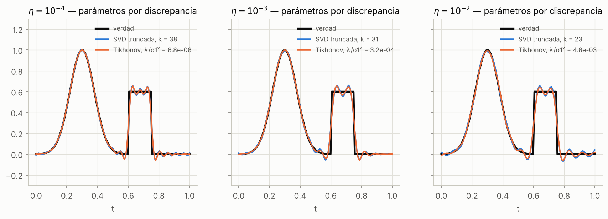

# Reconstrucción de señales con ruido: pseudoinversa, SVD truncada y Tikhonov

**Curso:** Álgebra Lineal Aplicada 2026-2 — Universidad del Pacífico
**Tema asignado:** Reconstrucción de señales con ruido (pseudoinversa, valores singulares y regularización de Tikhonov)
**Versión:** entrega parcial — etiqueta `avance-parcial`

**Integrantes:** Integrante A · Integrante B · Integrante C · Integrante D *(reemplazar por nombres reales)*

---

## Problema

Una señal $x_{\mathrm{true}}\in\mathbb R^{128}$ (una zona suave y un pulso rectangular) se observa a través de un suavizado gaussiano $A$ ($s=0.03$) y con ruido: $b=Ax_{\mathrm{true}}+e$, con nivel relativo $\eta\in\{10^{-4},10^{-3},10^{-2}\}$. Como $A$ atenúa casi por completo los detalles finos, la solución que mejor ajusta los datos amplifica el ruido. ¿Cómo reconstruir la señal sin amplificar lo que no sabemos y cómo elegir el parámetro de regularización **sin conocer** $x_{\mathrm{true}}$?

## Objetivo

1. Reproducir y verificar el ejemplo diagonal de dos coordenadas.
2. Comparar pseudoinversa numérica, SVD truncada y Tikhonov con error relativo, residuo y norma para los tres niveles de ruido.
3. Elegir el parámetro con el principio de discrepancia (sin $x_{\mathrm{true}}$) y cuantificar su distancia al mejor valor posible (oráculo).
4. Explicar con la SVD qué parte del error se debe al ruido y qué parte es información perdida.

## Estado de la entrega parcial

| Qué se entrega | Dónde |
|---|---|
| Problema, objetivo y alcance actualizados | `docs/desarrollo_matematico.md` §1 |
| Desarrollo matemático con demostraciones | `docs/desarrollo_matematico.md` |
| Implementación | `reconstruccion/` (paquete) y `scripts/` |
| Resultados preliminares, comprobaciones e interpretación | `docs/resultados_preliminares.md`, `resultados/` |
| Pruebas automáticas (23) | `tests/test_reconstruccion.py` |
| Guion del video | `docs/guion_video.md` |
| Responsabilidades, contribuciones, pendientes y cronograma | `docs/organizacion.md` |
| Declaración de uso de IA | `DECLARACION_IA.md` |

Completado: todos los pasos del experimento obligatorio (sección 9 del artículo), más robustez con 50 semillas y una exploración de $s$.
Pendiente: ampliación (penalización de diferencias o curva L/GCV), video y versión final. Detalle en `docs/organizacion.md`.

## Resultados principales (semilla 2026)

| $\eta$ | Pinv numérica (rango 89 de 128) | SVD truncada · discrepancia | Tikhonov · discrepancia | Tikhonov · oráculo |
|---|---|---|---|---|
| $10^{-4}$ | $8.1\times10^{7}$ | 0.094 ($k=38$) | 0.094 | 0.091 |
| $10^{-3}$ | $8.1\times10^{8}$ | 0.114 ($k=31$) | 0.109 | 0.101 |
| $10^{-2}$ | $8.1\times10^{9}$ | 0.122 ($k=23$) | 0.119 | 0.119 |

*(error relativo $\lVert x-x_{\mathrm{true}}\rVert/\lVert x_{\mathrm{true}}\rVert$)*

- La pseudoinversa ajusta los datos por debajo del nivel del ruido y aun así se equivoca por un factor de $10^{8}$ o más.
- Con regularización el error baja a 9–12 %. En 50 semillas, la discrepancia queda en mediana entre 0.5 % y 14 % por encima del oráculo.
- Subestimar el ruido a la mitad hace inviable la regla; sobrestimarlo al doble cuesta poco.
- El error restante es casi todo sesgo en los bordes del pulso: sin ruido, el mínimo posible sigue siendo 5.4 %.



## Organización del repositorio

```
├── README.md
├── DECLARACION_IA.md
├── requirements.txt
├── pytest.ini
├── reconstruccion/            # paquete con la implementación
│   ├── datos.py               #   señal, matriz de suavizado, ruido con semilla
│   ├── metodos.py             #   SVD, pinv, SVD truncada, Tikhonov (espectral, aumentado QR, normales)
│   ├── seleccion.py           #   discrepancia (sin x_true) y oráculo (con x_true)
│   └── metricas.py            #   error relativo, residuo, norma
├── scripts/
│   ├── comun.py               # parámetros del experimento y estilo de figuras
│   ├── 01_ejemplo_diagonal.py
│   ├── 02_experimento_principal.py
│   ├── 03_robustez.py         # 50 semillas, sensibilidad a delta, caso sin ruido
│   ├── 04_variacion_s.py      # exploración: s = 0.02, 0.03, 0.05
│   └── ejecutar_todo.py
├── tests/test_reconstruccion.py
├── docs/
│   ├── desarrollo_matematico.md
│   ├── resultados_preliminares.md
│   ├── guion_video.md
│   └── organizacion.md
└── resultados/                # generado por los scripts
    ├── configuracion.json     # semilla, tolerancias, sigma_i, versiones
    ├── figuras/*.png
    └── tablas/*.csv, *.md
```

## Cómo ejecutar

Requisitos: Python ≥ 3.10.

```bash
python -m venv .venv
source .venv/bin/activate        # Windows: .venv\Scripts\activate
pip install -r requirements.txt

python scripts/ejecutar_todo.py  # regenera resultados/ (≈ 6 s)
python -m pytest -q              # 23 pruebas
```

Cada script también se puede ejecutar por separado desde la raíz del repositorio, por ejemplo `python scripts/01_ejemplo_diagonal.py`.

### Parámetros y tolerancias registrados

| Parámetro | Valor |
|---|---|
| $n$, $s$ | 128, 0.03 |
| Semilla del vector $z$ | 2026 (la misma dirección para los tres $\eta$); robustez: semillas 1–50 |
| Malla de Tikhonov | 61 valores de $\lambda/\sigma_1^2$ entre $10^{-10}$ y $1$ (6 por década) |
| SVD truncada | $k=1,\dots,128$ |
| Discrepancia | $\tau=1.1$, $\delta=\lVert e\rVert$ |
| Tolerancia de `scipy.linalg.pinv` | por defecto, `rtol = max(m,n)·eps` → umbral $2.84\times10^{-14}$, rango 89 |

## Video

*Pendiente (entrega final).* Enlace: —

## Referencias

[1] O. Velásquez Castañón, "Reconstrucción de señales con ruido: pseudoinversa, valores singulares y regularización de Tikhonov," material de referencia para proyectos, Álgebra Lineal Aplicada 2026-2, Universidad del Pacífico, oct. 2026.

[2] P. C. Hansen, *Rank-Deficient and Discrete Ill-Posed Problems: Numerical Aspects of Linear Inversion*. Philadelphia, PA, USA: SIAM, 1998, doi: 10.1137/1.9780898719697.

[3] P. C. Hansen, *Discrete Inverse Problems: Insight and Algorithms*. Philadelphia, PA, USA: SIAM, 2010, doi: 10.1137/1.9780898718836.

[4] S. Gazzola, P. C. Hansen y J. G. Nagy, "IR Tools: a MATLAB package of iterative regularization methods and large-scale test problems," *Numerical Algorithms*, vol. 81, pp. 773–811, 2019, doi: 10.1007/s11075-018-0570-7.

[5] SciPy, "scipy.linalg.pinv" y "scipy.linalg.lstsq," documentación de SciPy. [En línea]. Disponible: https://docs.scipy.org/doc/scipy/reference/generated/scipy.linalg.pinv.html

[6] A. N. Tikhonov, "Solution of incorrectly formulated problems and the regularization method," *Soviet Mathematics Doklady*, vol. 4, pp. 1035–1038, 1963.

[7] V. A. Morozov, "On the solution of functional equations by the method of regularization," *Soviet Mathematics Doklady*, vol. 7, pp. 414–417, 1966.

[8] G. H. Golub y C. F. Van Loan, *Matrix Computations*, 4.ª ed. Baltimore, MD, USA: Johns Hopkins University Press, 2013.
